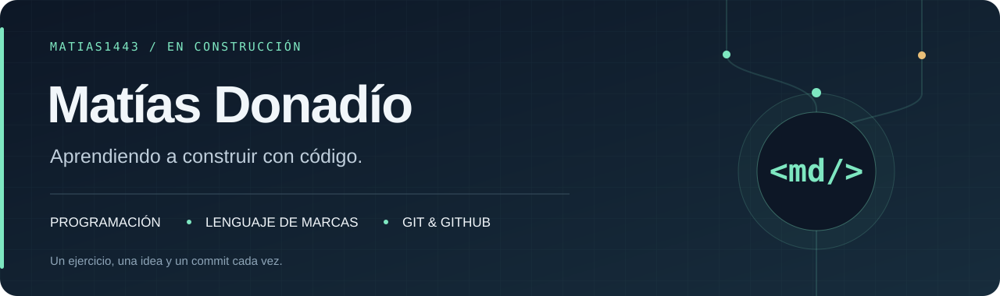

  

  <a href="#sobre-mí">Sobre mí</a> &nbsp; / &nbsp;
  <a href="#tecnologías-en-práctica">Tecnologías</a> &nbsp; / &nbsp;
  <a href="#proyectos">Proyectos</a> &nbsp; / &nbsp;
  <a href="#mi-forma-de-aprender">Cómo aprendo</a>

## Sobre mí

Soy **Matías** y estoy aprendiendo programación y lenguaje de marcas. Este perfil es mi cuaderno de desarrollo: aquí reúno ejercicios, documento lo que hago y practico el control de versiones.

Me interesa entender cómo funcionan las cosas, escribir código que se pueda leer y convertir conceptos en pequeños proyectos que se puedan ejecutar.

## Tecnologías en práctica

  
  
  
  
  
  

**Ahora:** métodos, arrays y validaciones en Java; estructura semántica, diseño adaptable y datos XML en la web.

## Proyectos

<table>
  <tr>
    <td valign="top" width="50%">
      <h3>01 / Java</h3>
      
Fundamentos de programación, paso a paso.

      
Calculadora con control de división por cero, estadísticas de arrays y conversión de temperaturas.

      
<code>Java</code> <code>Métodos</code> <code>Arrays</code>

      
<a href="https://github.com/Matias1443/Java"><strong>Explorar los ejercicios →</strong></a>

    </td>
    <td valign="top" width="50%">
      <h3>02 / Lenguaje de marcas</h3>
      
Estructura, presentación y datos para la web.

      
Página HTML semántica, hoja de estilos adaptable a móviles y catálogo de ejercicios en XML.

      
<code>HTML</code> <code>CSS</code> <code>XML</code>

      
<a href="https://github.com/Matias1443/Lenguaje_de_marcas"><strong>Explorar la página →</strong></a>

    </td>
  </tr>
</table>

## Mi forma de aprender

**01 · Entender** — Dividir cada problema en pasos pequeños.  
**02 · Construir** — Llevar la idea al código y comprobar el resultado.  
**03 · Documentar** — Explicar cómo ejecutar cada ejercicio y registrar los cambios con Git.

<strong>Documentación que me acompaña</strong>

- [dev.java](https://dev.java/learn/) · Fundamentos y ejemplos de Java.
- [MDN Web Docs](https://developer.mozilla.org/es/) · HTML y CSS.
- [Documentación de Git](https://git-scm.com/doc) · Control de versiones.

---

Aprender · Construir · Documentar

